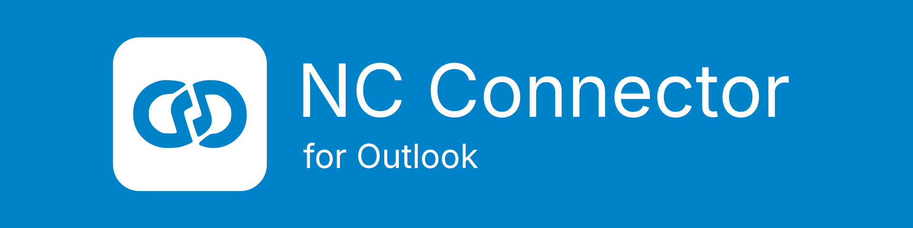
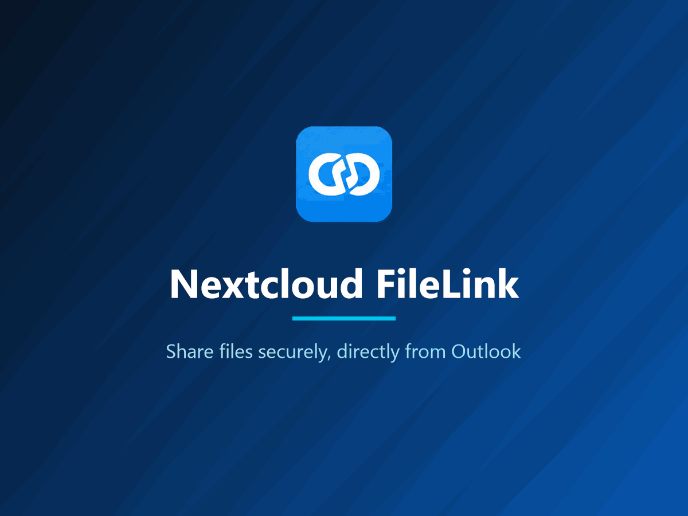
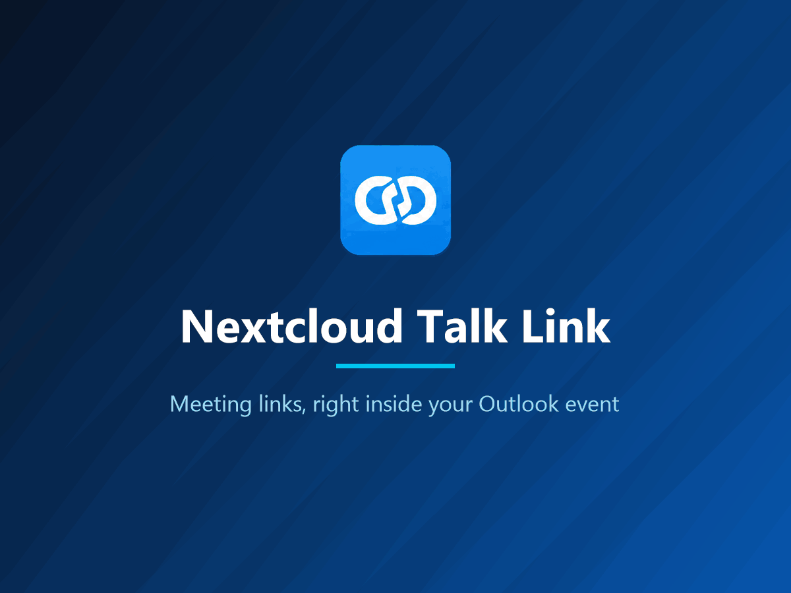
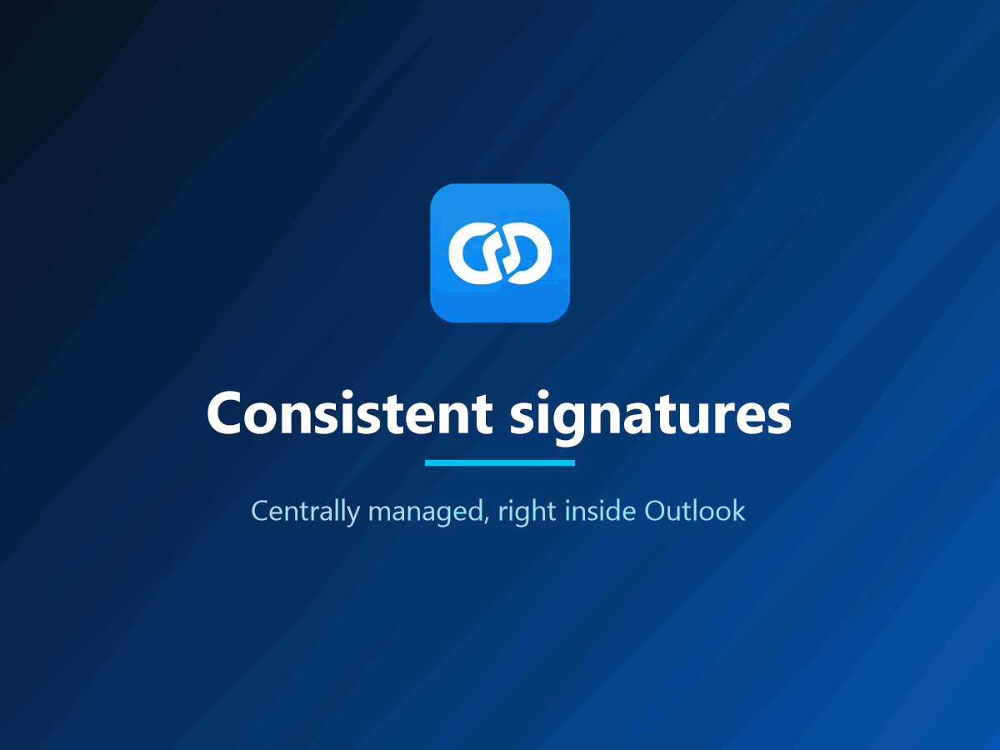
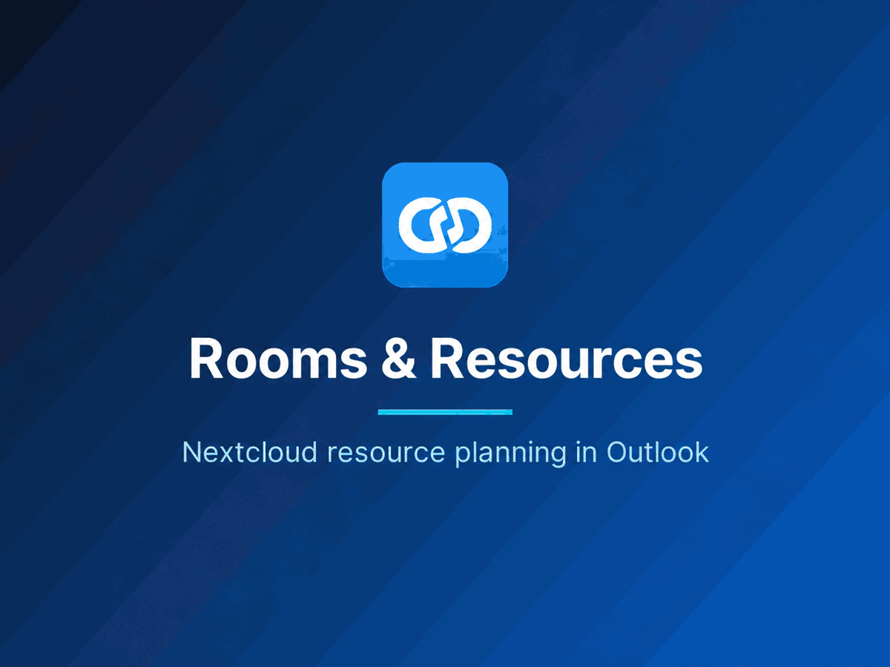

# NC Connector for Outlook

  <strong>Your Nextcloud, inside Outlook Classic.</strong> 
  Share files, create Talk meetings, find rooms and resources, and keep your team’s signatures consistent, all from your mail and calendar.

  <a href="https://github.com/nc-connector/NC_Connector_for_Outlook/releases/latest"><strong>Download the installer</strong></a>
  &nbsp;·&nbsp;
  <a href="https://github.com/nc-connector/NC_Connector_for_Outlook/blob/main/docs/ADMIN.md#contents">Admin guide</a>
  &nbsp;·&nbsp;
  <a href="https://nc-connector.de/">Website</a>
  &nbsp;·&nbsp;
  <a href="https://github.com/nc-connector/NC_Connector_for_Outlook/blob/main/README.de.md">Deutsch</a>

For **Outlook Classic on Windows**, including new messages, replies, forwards, and inline replies. The new Outlook is not supported. Looking for Thunderbird? [Get the Thunderbird add-on](https://github.com/nc-connector/NC_Connector_for_Thunderbird).

---

## See it in action

Four workflows, shown in Outlook Classic. Expand a section to watch the demo.

<strong>Share files instead of sending large attachments</strong>

Combine files and folders from your computer and **My Nextcloud** in one share. Add a password, expiration date, and access permissions, then insert the link into your message. Existing Nextcloud files are copied into the share; the originals stay unchanged.

  

Attachment rules can offer sharing when a size limit is reached or handle attachments automatically. Choose a share-page link or a direct ZIP download. Share blocks adapt to HTML, RTF, and plain-text messages.

*Works with local settings, without NC Connector Backend.*

<strong>Create a Nextcloud Talk meeting from your calendar</strong>

Create a Talk room from an Outlook appointment and insert the meeting link. Configure password protection, a lobby, and moderation options without switching to the browser. Keep the Talk meeting in sync when the appointment changes.

  

*Works with local settings, without NC Connector Backend. Requires Nextcloud Talk.*

<strong>Keep your team's email signatures consistent</strong>

Design signature templates centrally in Nextcloud, use placeholders for user details, and apply the result to matching sender identities in Outlook. Signatures for unrelated accounts stay untouched.

  

*Requires the optional backend and a valid assigned seat. The free Community seat is sufficient.*

<strong>Find rooms and resources for your next meeting</strong>

Find rooms and equipment published through Nextcloud, including RoomVox and Calendar Resource Management. Filter by building, floor, capacity, equipment, and availability. Add one room and multiple resources to the appointment, or open a resource's day view to inspect free/busy times.

  

*Requires the backend and a valid assigned seat.*

Selection is not a booking confirmation. Use a Nextcloud calendar configured in **CalDAV Synchronizer**, save and synchronize the appointment, then check the resource's response.

## Optional backend. One full-featured seat included.

File sharing, **My Nextcloud**, Talk, attachment rules, and Internet Free/Busy work without the backend using local settings.

For centrally managed installations, add [NC Connector Backend](https://apps.nextcloud.com/apps/ncc_backend_4mc) to Nextcloud. It includes **one free Community seat**, assigned to one Nextcloud user. That seat unlocks the **same seat-based features as paid seats**; paid plans add seats for more users.

- Central settings, administrator locks, and delegated management
- Low-touch enterprise rollout with user-friendly sign-in
- Managed signatures, custom templates, and branding
- Room and resource picker with filters and availability checks
- Separate password delivery by email or one-time Nextcloud Secrets links; Secrets links also require the Secrets app

Users in a centrally managed setup need the corresponding backend access and assigned seat.

[Install the free backend](https://apps.nextcloud.com/apps/ncc_backend_4mc) · [Plans and licensing](https://nc-connector.de/preise-lizenzierung/)

## Get started

1. Save your work and close Outlook.
2. Download and run the **MSI installer** from the [latest release](https://github.com/nc-connector/NC_Connector_for_Outlook/releases/latest).
3. Start Outlook and open **NC Connector → Settings**.
4. Enter your Nextcloud URL and sign in with **Nextcloud Login** or an app password.
5. Test the connection and save your settings.

The installer upgrades an existing installation while retaining personal settings. For managed deployment, follow the [enterprise rollout guide](https://github.com/nc-connector/NC_Connector_for_Outlook/blob/main/docs/ADMIN.md#enterprise-rollout).

### What you need

- **Outlook Classic 2019 or newer**, 32-bit or 64-bit, on 64-bit Windows 10 or 11
- **.NET Framework 4.7.2** and administrator rights for installation
- **Nextcloud 32 or newer** over HTTPS, with Files Sharing enabled, permission to create public links, and sufficient storage
- **Nextcloud Talk** for online meetings
- **CalDAV Synchronizer** configured for the Nextcloud calendar when booking rooms and resources

### Free/busy in Outlook's Scheduling Assistant

NC Connector can provide Nextcloud free/busy data through a local **Internet Free/Busy (IFB)** proxy. This is separate from the seat-based room and resource picker and works with local settings without the backend when the installation is not centrally managed.

See [Configure Internet Free/Busy](https://github.com/nc-connector/NC_Connector_for_Outlook/blob/main/docs/ADMIN.md#configure-internet-freebusy) for setup and troubleshooting.

## Documentation

- [Admin guide](https://github.com/nc-connector/NC_Connector_for_Outlook/blob/main/docs/ADMIN.md#contents): setup, rollout, policies, updates, and troubleshooting
- [Development guide](https://github.com/nc-connector/NC_Connector_for_Outlook/blob/main/docs/DEVELOPMENT.md): build, tests, and architecture
- [Changelog](https://github.com/nc-connector/NC_Connector_for_Outlook/blob/main/CHANGELOG.md) · [Supported languages](https://github.com/nc-connector/NC_Connector_for_Outlook/blob/main/Translations.md) · [Screenshots](https://github.com/nc-connector/NC_Connector_for_Outlook/tree/main/Screenshots)
- [License](https://github.com/nc-connector/NC_Connector_for_Outlook/blob/main/LICENSE.txt) · [Third-party components](https://github.com/nc-connector/NC_Connector_for_Outlook/blob/main/VENDOR.md)

## Open source, with clear data paths

File sharing and Talk use your own Nextcloud. File contents are not relayed through an NC Connector-hosted service.

The daily update check also provides an anonymous count of active users. Backend license checks are separate from file transfers.

[Trust and transparency](https://nc-connector.de/vertrauen-transparenz/) · [Public roadmap](https://github.com/orgs/nc-connector/projects/1)

## Help and feedback

Found a bug or have a feature request? [Open an issue](https://github.com/nc-connector/NC_Connector_for_Outlook/issues). Include your Outlook, add-in, and Nextcloud versions, plus steps to reproduce. Remove credentials and personal information from logs and screenshots.

For rollout questions, [get in touch](https://nc-connector.de/kontakt/). If NC Connector helps you, a GitHub star helps others find it.
